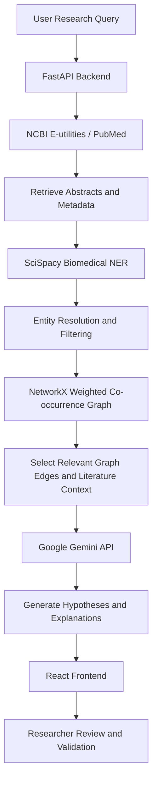

# BioCause AI

### A Decoupled GraphRAG Architecture for Automated Literature-Based Discovery and Causal Hypothesis Generation

**[📄 Read Research Paper](https://drive.google.com/file/d/1NJ6f-V_un_iD99zXIX8IBY9Nh4wcge7v/view?usp=drivesdk)** · **[💻 GitHub Repository](https://github.com/KalkiDh/BioCauseAI)**

BioCause AI is a research-oriented, full-stack biomedical literature discovery platform that explores potential connections across scientific research papers. It combines PubMed literature retrieval, biomedical Named Entity Recognition (NER), knowledge graph construction, and graph-grounded Large Language Model (LLM) reasoning to generate interpretable causal hypotheses for further investigation.

> **Disclaimer:** BioCause AI is a research prototype. Its outputs are hypotheses for scientific exploration, not established causal relationships, clinical conclusions, or medical advice. All findings require independent validation.

---

## Table of Contents

- [Overview](#overview)
- [Key Features](#key-features)
- [System Architecture](#system-architecture)
- [How It Works](#how-it-works)
- [Technology Stack](#technology-stack)
- [Reported Evaluation](#reported-evaluation)
- [Research Case Study](#research-case-study)
- [Limitations](#limitations)
- [Getting Started](#getting-started)
- [Project Structure](#project-structure)
- [Research Publication](#research-publication)
- [Contributors](#contributors)
- [Acknowledgements](#acknowledgements)

---

## Overview

Biomedical knowledge is distributed across a large and continuously growing body of scientific literature. Connections between diseases, chemicals, and biological mechanisms may be described across separate publications, making them difficult to discover through conventional keyword searches alone.

BioCause AI explores a graph-based approach to **Literature-Based Discovery (LBD)**. It extracts biomedical entities from retrieved PubMed abstracts, constructs a weighted co-occurrence knowledge graph, and uses graph-derived relationships and literature context to guide LLM reasoning.

The application follows a decoupled architecture with a **React frontend** and a **FastAPI backend**, separating computational processing from the user interface.

## Key Features

- **PubMed Integration:** Retrieves biomedical literature and abstracts using NCBI E-utilities.
- **Biomedical Named Entity Recognition:** Uses SciSpacy-based natural language processing to identify biomedical entities.
- **Knowledge Graph Construction:** Represents entities as nodes and their co-occurrences as weighted edges using NetworkX.
- **Graph Filtering:** Filters lower-weight connections to reduce irrelevant relationships.
- **Graph-Grounded LLM Reasoning:** Uses the Google Gemini API to help generate hypotheses from selected graph relationships and literature context.
- **Interpretable Relationships:** Organizes potential connections into understandable hypothesis chains.
- **Interactive Interface:** Uses React to present findings and relationships.
- **Decoupled Architecture:** Separates backend processing, graph analysis, and frontend rendering.

---

## System Architecture



The architecture separates literature retrieval, entity extraction, graph construction, and LLM-based reasoning. Graph-derived context helps guide hypothesis generation instead of relying exclusively on unconstrained language-model output.

## How It Works

1. **Research Query:** The user provides a biomedical topic or research question.
2. **Literature Retrieval:** PubMed is queried using NCBI E-utilities to retrieve relevant publications and abstracts.
3. **Entity Extraction:** SciSpacy identifies relevant biomedical entities, particularly diseases and chemicals.
4. **Graph Construction:** NetworkX builds a weighted graph from entity co-occurrences across abstracts.
5. **Noise Filtering:** Low-weight edges and less relevant relationships are filtered.
6. **Hypothesis Generation:** Selected graph relationships and literature context are supplied to the Gemini API for reasoning.
7. **Results Presentation:** The React interface presents generated findings for further investigation.

---

## Technology Stack

| Component | Technology |
|---|---|
| Frontend | React |
| Backend | Python, FastAPI |
| Biomedical NLP | SciSpacy |
| Literature Retrieval | PubMed / NCBI E-utilities |
| Knowledge Graph | NetworkX |
| LLM Reasoning | Google Gemini API |
| API Server | Uvicorn |

---

## Reported Evaluation

The following results are reported in the accompanying research paper. They describe the prototype's reported experiments and are not independent clinical validation.

| Evaluation Metric | Reported Result |
|---|---:|
| Largest evaluated corpus | 1,000 PubMed abstracts |
| Raw co-occurrences | Approximately 5,900 |
| Filtered hypotheses/connections | Approximately 530 |
| LLM Gatekeeper precision | 0.94 |
| LLM Gatekeeper F1-score | 0.89 |
| LLM Gatekeeper recall | 0.85 |
| Pipeline latency for 50 papers | Approximately 11.10 seconds |

### Reported Pipeline Latency

| Pipeline Stage | Average Execution Time |
|---|---:|
| PubMed API fetch | 1.25 seconds |
| SciSpacy NER extraction | 3.80 seconds |
| Entity resolution and canonicalization | 1.10 seconds |
| Graph construction | 0.45 seconds |
| Final LLM reasoning generation | 4.50 seconds |
| **Total** | **Approximately 11.10 seconds** |

The paper reports that the LLM Gatekeeper improved precision from 0.42 to 0.94, while recall changed from 0.88 to 0.85. These results represent internal module comparisons rather than direct comparisons against external LBD or GraphRAG systems.

---

## Research Case Study

The research explores a historical literature-based discovery involving dietary fish oil and Raynaud's disease, connected through an intermediate mechanism associated with blood viscosity.

The case study demonstrates how relationships discussed across different publications may be connected through a knowledge graph. It serves as a proof of concept and should not be interpreted as clinical validation of newly generated hypotheses.

---

## Limitations

- The principal historical case study is a proof of concept rather than broad validation across numerous disease–chemical relationships.
- The evaluation does not provide a direct head-to-head comparison with external LBD or GraphRAG systems.
- Co-occurrence weighting and evidence prioritization include heuristic choices.
- SciSpacy may fail to recognize unfamiliar or newly introduced biomedical entities.
- LLM-generated hypotheses may contain unsupported claims despite graph grounding.
- The reported metrics require broader validation using curated ground-truth datasets and expert assessment.

BioCause AI is intended to support exploratory research. Scientific conclusions should always be checked against original publications and validated by domain experts.

---

## Getting Started

The commands below are general examples. Verify them against the actual repository structure, dependency files, and application entry points before running them.

### Prerequisites

- Python
- Node.js and npm
- Google Gemini API key
- Internet access for PubMed / NCBI E-utilities

### 1. Clone the Repository

```bash
git clone https://github.com/KalkiDh/BioCauseAI.git
cd BioCauseAI
```

### 2. Configure Environment Variables

If the backend expects a Gemini API key through an environment variable, configure it in the appropriate local environment file:

```env
GEMINI_API_KEY=your_api_key_here
```

Use the exact variable name required by your implementation. Never commit API keys or other secrets to GitHub.

### 3. Install Backend Dependencies

If the backend contains a `requirements.txt` file, a typical setup may look like this:

```bash
python -m venv .venv
```

**Windows:**

```bash
.venv\Scripts\activate
```

**macOS/Linux:**

```bash
source .venv/bin/activate
```

Then install dependencies:

```bash
pip install -r requirements.txt
```

If the FastAPI entry point is `main.py` and the application object is named `app`, you can start it with:

```bash
uvicorn main:app --reload
```

Adjust the command to match the actual backend entry point.

### 4. Install Frontend Dependencies

If the frontend uses npm and contains a `package.json` file:

```bash
npm install
npm run dev
```

Run these commands from the frontend directory and check the available scripts in `package.json`.

---

## Project Structure

The following is a conceptual structure; refer to the repository for the actual directory and file names.

```text
BioCauseAI/
├── backend/
│   ├── API routes
│   ├── Biomedical NLP processing
│   ├── Knowledge graph construction
│   └── LLM reasoning
├── frontend/
│   ├── React components
│   └── User interface
├── README.md
└── ...
```

---

## Research Publication

**Title:** BioCause AI: A Decoupled GraphRAG Architecture for Automated Literature-Based Discovery and Causal Hypothesis Generation

**Authors:** Pratik Raj, Dron Haritwal, and Rajeswari D

**Conference:** ComNet 2026 — International Conference on Communication Systems and Networks

**Presentation Date:** 17 September 2026

**Research Paper:** [Read the full paper on Google Drive](https://drive.google.com/file/d/1NJ6f-V_un_iD99zXIX8IBY9Nh4wcge7v/view?usp=drivesdk)

The paper was presented at ComNet 2026, held from 16–18 September 2026. Refer to the official proceedings or publication record for confirmed publication and indexing details.

---

## Contributors

- **Pratik Raj**
- **Dron Haritwal**
- **Rajeswari D**

---

## Acknowledgements

- **PubMed / NCBI** for biomedical literature access through E-utilities.
- **SciSpacy** for biomedical natural language processing.
- **NetworkX** for graph representation and analysis.
- **Google Gemini API** for language-model reasoning.

---

If you use or build upon this work, please cite the research paper when an official publication record and complete citation details are available.
